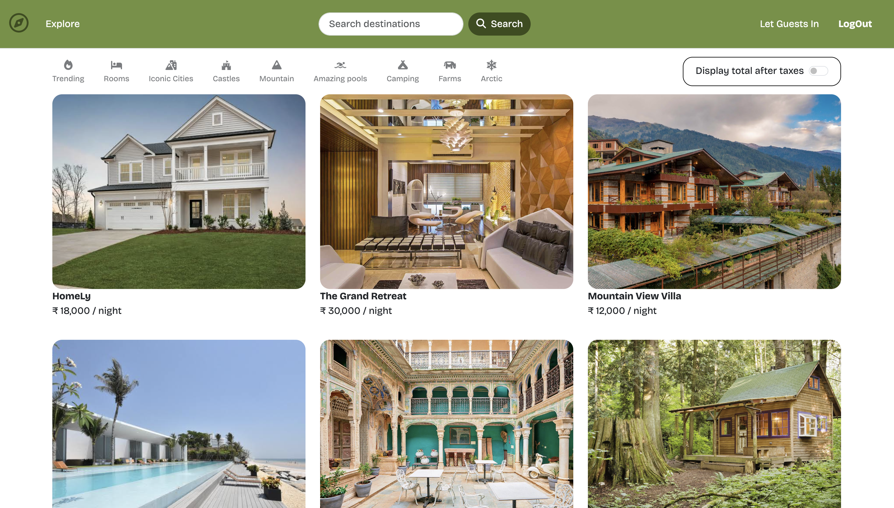
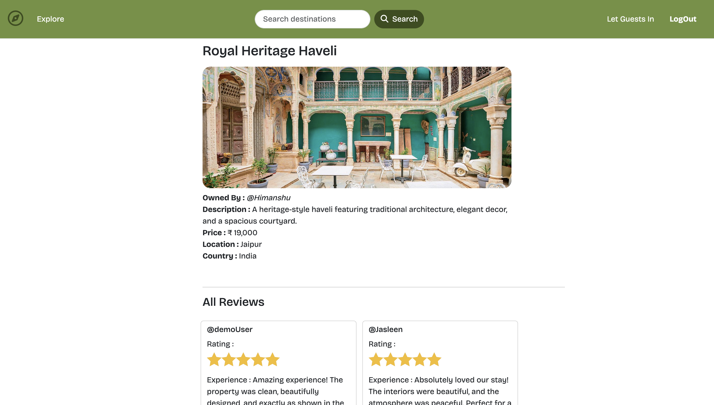
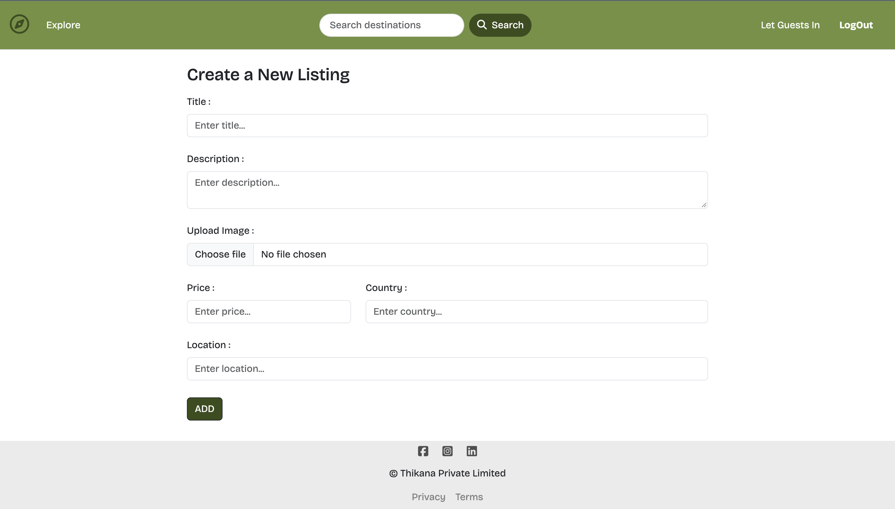
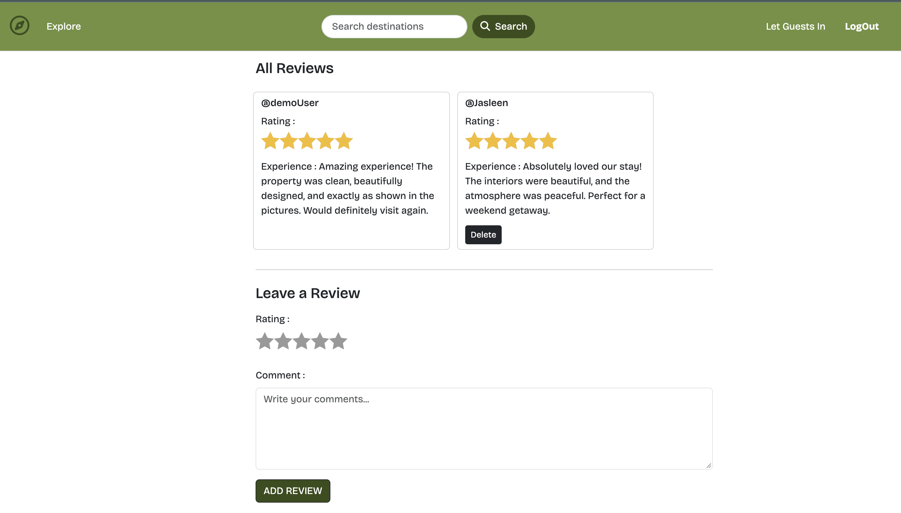
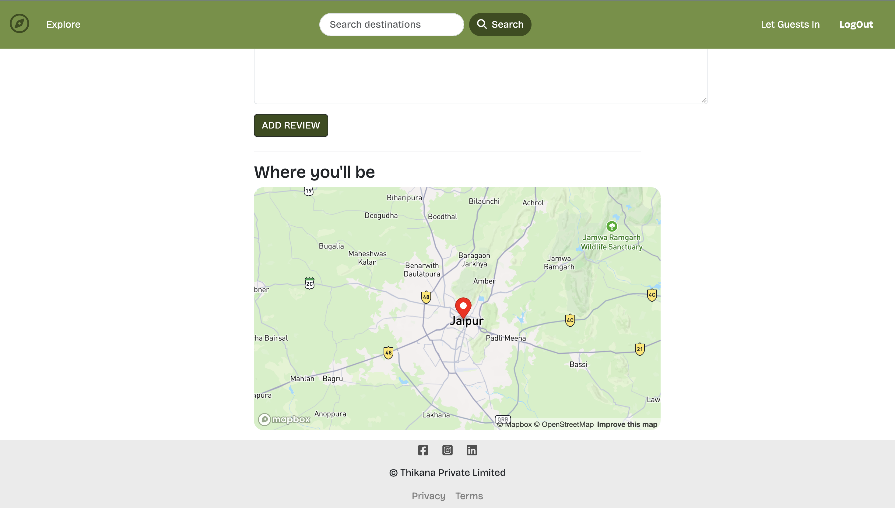

# 🏡 Thikana - Discover Your Perfect Stay

Thikana is a full-stack vacation rental platform inspired by Airbnb, built to make discovering and exploring properties simple and convenient.

Users can explore property listings, view detailed property information and locations on an interactive map, create and manage their own listings, and share experiences through reviews and ratings.

<br>

> Note: Property booking functionality is planned for a future version.

<br>

## 🌐 Live Demo

🔗 **Explore Thikana:** https://thikana-qndb.onrender.com

<br>


## 📸 Screenshots

Here are some screenshots showcasing the application’s interface and functionality.


### 🏠 Home Page



### 🏡 Property Details



### ➕ Create Listing



### ⭐ Reviews & Ratings



### 🗺️ Interactive Map




<br>

## Features

🏠 **Explore Properties:** Browse vacation rental listings and view their details.

🔐 **User Authentication:** Register and log in to access user-specific functionality.

➕ **Create Listings:** Add new properties with relevant details and image.

✏️ **Manage Listings:** Edit and delete listings, subject to ownership permissions.

⭐ **Reviews & Ratings:** Share experiences and leave reviews on properties.

🗺️ **Interactive Maps:** Explore locations with Mapbox integration.

🔒 **Authorization:** Restrict listing management and other protected actions to authorized users.

<br>

## 🛠️ Tech Stack

* **Frontend:** HTML5, CSS3, JavaScript, EJS, EJS-Mate, Bootstrap
* **Backend:** Node.js, Express.js
* **Database:** MongoDB, Mongoose
* **Authentication & Sessions:** Passport.js, Passport-Local, Passport-Local-Mongoose, Express Session, Connect-Mongo
* **Image Upload & Storage:** Multer, Cloudinary, Multer-Storage-Cloudinary
* **Maps & Geocoding:** Mapbox SDK
* **Validation:** Joi
* **Utilities:** Method-Override, Connect-Flash, Dotenv


<br>


## 🏗️  Application Architecture

Thikana follows the MVC (Model-View-Controller) architectural pattern, separating data management, presentation, and application logic to keep the codebase organized and maintainable.

* **Models:** Manage application data and define MongoDB schemas for users, property listings, and reviews using Mongoose.
* **Views:** Generate dynamic web pages using EJS and EJS-Mate, enabling reusable layouts and consistent page rendering.
* **Controllers:** Handle the core application logic for property listings, reviews, and user-related operations.
* **Routes:** Define application endpoints and direct incoming HTTP requests to the appropriate handlers.
* **Middleware:** Manage authentication, authorization, input validation, session handling, and error processing to support secure and reliable request handling.


<br>


## 🚀  Getting Started

Follow these steps to run Thikana locally.


### 🔵 Prerequisites

Make sure you have the following installed or configured:

🌐 [Node.js](https://nodejs.org/)

🌐 [⁠MongoDB Atlas account](https://www.mongodb.com/cloud/atlas)

🌐 [⁠Mapbox access token](https://www.mapbox.com/)

🌐 [Cloudinary credentials](https://cloudinary.com/)

<br>

### ⚙️ Installation

**1. Clone the repository**

```bash
git clone https://github.com/hhimanshu01/Thikana.git
cd Thikana
```

**2. Install dependencies**

```bash
npm install
```

**3. Configure environment variables**

Create a .env file in the root directory:

```env
ATLASDB_URL=your_mongodb_connection_string
SECRET=your_session_secret
CLOUD_NAME=your_cloudinary_cloud_name
CLOUD_API_KEY=your_cloudinary_api_key
CLOUD_API_SECRET=your_cloudinary_api_secret
MAP_TOKEN=your_mapbox_access_token
```

Replace the placeholder values with your actual credentials.

**4. Start the application**

```bash
node app.js
```

**5. Open the application**

Visit the following URL in your browser, assuming your application runs on port 8080:

```text
http://localhost:8080
```

    
## 📂 Project structure

```text
Thikana/
├── controllers/       # Request handling and application logic
├── models/            # Database models and schemas
├── routes/            # Application routes
├── views/             # EJS templates
│   ├── includes/
│   └── layouts/
├── public/            # CSS, JavaScript, and static assets
│   ├── css/
│   └── js/
├── utils/             # Utility functions
├── init/
├── app.js             # Application entry point
├── middleware.js      # Custom middleware
├── schema.js
├── cloudConfig.js
└── package.json       # Dependencies and project configuration
```


## 🚧  Future Enhancements

* **Booking System:** Allow users to reserve properties for selected dates.
* **Wishlist:** Allow users to save their favorite properties.
* **Advanced Search & Filters:** Filter properties by location, price, and other criteria.
* **Payment Integration:** Introduce secure online payments alongside the booking system.


## 👨‍💻 Author

#### Himanshu

* **Github:** [@hhimanshu01](https://github.com/hhimanshu01)
* **LinkedIn:** [@hhimanshu01](https://www.linkedin.com/in/hhimanshu01/)
